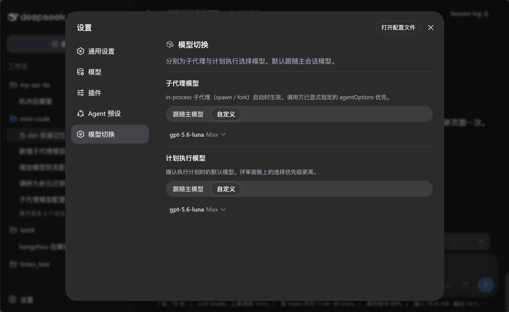
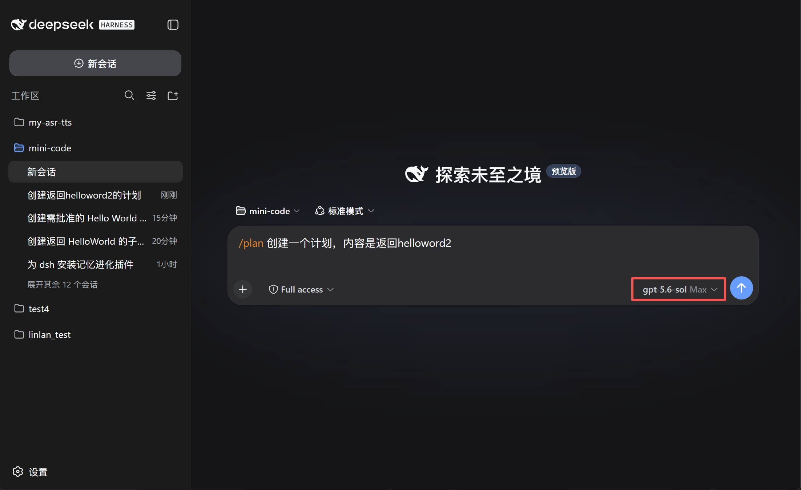
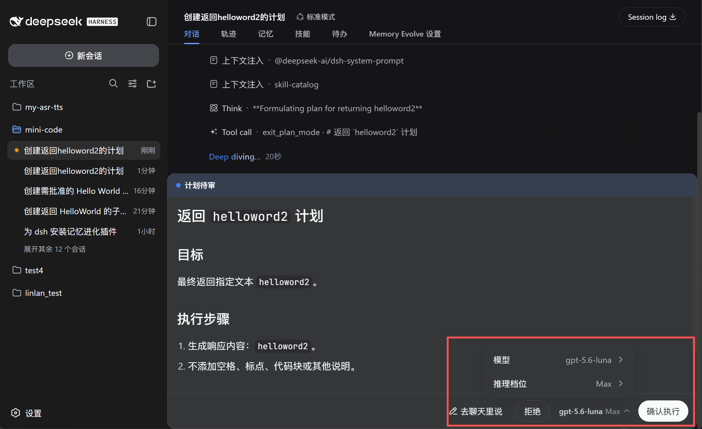
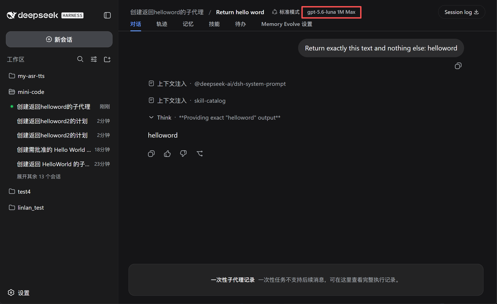

# dsh-model-switch

English | [中文](README.zh.md)

Use the right model for each stage of work in DeepSeek Harness.

The main conversation, subagents, and plan execution serve different purposes. `dsh-model-switch` lets each of them use a suitable model without changing the normal DSH workflow.

## Why use it

- **Match models to tasks** — keep your preferred model in the main conversation and use another model for subagents or plan execution.
- **Avoid repeated switching** — save defaults once instead of changing models before every task.
- **Confirm before execution** — review or change the model directly in the plan approval panel.
- **See what subagents use** — display the model, context window, and reasoning effort, such as `GPT-5.6 Sol 1M Max`.
- **Keep the main model unchanged** — after plan execution, DSH restores the previous main-session model.

## Preview

### Configure model defaults



### Choose the model for plan execution

<table>
  <tr>
    <td width="50%"></td>
    <td width="50%"></td>
  </tr>
</table>

### See the model used by a subagent

Open a subagent session to see its model, context window, and reasoning effort in the session header.



## Install

Use the GitHub spec for this fork. It is not published as an npm package.

```bash
dsh plugin --profile web add github:SA2687890878/dsh-model-switch
```

Replace `web` with the profile DSH is actually running. DeepSeek Harness Desktop typically uses `desktop`.

Restart DSH after installation.

## Update DSH

This fork has been typechecked and built against DeepSeek Harness **0.2.0-rc.2**. The manifest declares the compatible peer range `^0.2.0-rc.2`; later releases are not runtime-tested by this change.

If you upgrade DSH, use the normal channel for that installation. Desktop updates its bundled DSH through the app updater; updating npm or `npx` does not replace Desktop's copy. Follow DSH release notes and back up `~/.dsh` (Windows: `%USERPROFILE%\.dsh`) before crossing a release that changes on-disk formats.

After a DSH upgrade, reinstall this fork with `--force` as described below.

## Reinstall / after a DSH update

Reinstall the plugin when this fork changes, or after you upgrade DeepSeek Harness. This change was verified against **0.2.0-rc.2**; the package peer range is `^0.2.0-rc.2`.

1. Update DSH first (see [Update DSH](#update-dsh); skip this step if only the plugin changed).
2. Reinstall with `--force` so DSH refreshes the GitHub source:

```bash
dsh plugin --profile web add --force github:SA2687890878/dsh-model-switch
```

3. Restart DSH.

On Desktop, run **one** `plugin add` at a time. Fully **Exit** from the tray (closing the window is not enough), wait until Desktop finishes starting, then reinstall, then Exit and reopen again. If install fails with `another plugin install recovery transaction is pending`, quit Desktop, wait, and retry once. If it is still pending, quit Desktop, delete `%APPDATA%\DSH Desktop\plugin-install-recovery`, reopen Desktop, then run a single `add --force`.

To bypass the Desktop wrapper, run the matching DSH CLI in a normal terminal:

```powershell
dsh plugin --profile desktop add --force github:SA2687890878/dsh-model-switch
```

## Use

1. Open **Settings → Model switch**.
2. Configure the **Subagent model** and **Plan execution model**:
   - **Follow main model** uses the current conversation model.
   - **Custom** lets you choose a model and reasoning effort.
3. When reviewing a plan, confirm or change the execution model before selecting **Approve**.

The model selected in the plan review panel takes priority over the saved plan-execution setting.

## Compatibility

Built and typechecked against DeepSeek Harness **0.2.0-rc.2** (peer range `^0.2.0-rc.2`). Settings are the plugin entry's validated `Config`, persisted through DSH's settings Remote under the loader entry id `model-switch`.

Subagent model switching applies to in-process subagents such as `spawn` and `fork`. External-process agents may manage their models independently.

DSH 0.1.2-alpha.1 also introduced a native, agent-driven model selection for subagents (the agent picks provider/model/effort within its authorization). This plugin is complementary: it enforces a fixed, user-configured routing policy instead, and adds the plan-execution model switch, restore, and session model badges.

## Community


## Links

- [Linux.do](https://linux.do)

## License

MIT
